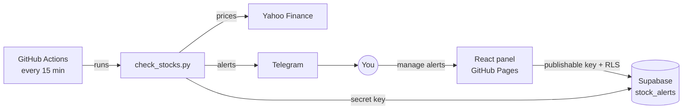

# 📈 Stock Alert Bot

A lightweight, serverless stock price alert system. Define price thresholds for any ticker in a web panel, and a scheduled bot checks the market every 15 minutes during US trading hours, flags the alerts that were hit and pings you on Telegram.

No servers to maintain: the bot runs on **GitHub Actions**, the panel is hosted on **GitHub Pages**, and the data lives in **Supabase**.

## ✨ Features

- **Low / high price targets** - get notified when a stock drops below or rises above your threshold (either one or both).
- **Telegram notifications** - instant message when an alert triggers (optional).
- **No notification spam** - an alert fires once and stays triggered until the price moves back by a 1% buffer, so prices hovering around the target don't produce repeated messages.
- **Automatic reset** - changing a ticker or its targets clears the alert status (handled by a database trigger).
- **Web panel** - add, edit, enable/disable and delete alerts; see the last price, status and update time at a glance.
- **Passwordless login** - email magic link via Supabase Auth, invite-only.
- **Multilingual UI** - English and Polish, auto-detected from the browser.
- **Batch price fetching** - all tickers are downloaded in a single Yahoo Finance request.

## 🏗️ Architecture



| Component | Tech | Location |
|-----------|------|----------|
| Price checker bot | Python 3.11+, yfinance, supabase-py | [`backend/`](backend) |
| Web panel | React 19, Vite, TypeScript, Mantine, i18next | [`frontend/`](frontend) |
| Database | Supabase (Postgres + RLS + Auth) | [`supabase/migrations/`](supabase/migrations) |
| Scheduling & hosting | GitHub Actions, GitHub Pages | [`.github/workflows/`](.github/workflows) |

## 🔔 How alerts work

Each run, the bot loads all active alerts, fetches the latest prices and resolves a status for every alert:

| Condition | Status |
|-----------|--------|
| `price <= low_target` | `ALERT_DROP` 📉 |
| `price >= high_target` | `ALERT_RISE` 📈 |
| Already triggered and price still within 1% of the target | unchanged |
| Otherwise | `null` (OK) |

A Telegram message is sent only when the status **changes** into `ALERT_DROP` or `ALERT_RISE`. The bot also stores `last_price` and `updated_at`, which the panel displays.

## 🚀 Getting started

### Prerequisites

- A [Supabase](https://supabase.com) project
- Python 3.11+ (or Docker) for the bot
- Node.js 24+ for the frontend
- *(optional)* A Telegram bot from [@BotFather](https://t.me/BotFather)

### 1. Set up the database

In the Supabase **SQL Editor**, run the migrations in order:

1. [`20261020000000_create_stock_alerts.sql`](supabase/migrations/20261020000000_create_stock_alerts.sql) - creates the `stock_alerts` table
2. [`20261021000000_stock_alerts_frontend.sql`](supabase/migrations/20261021000000_stock_alerts_frontend.sql) - RLS policy, target validation and status-reset trigger

Then configure **Authentication**:

- **Sign In / Providers** - disable *Allow new users to sign up* (the RLS policy lets any authenticated user manage alerts, so sign-ups must be closed).
- **Users -> Add user** - add your own email.
- **URL Configuration** - add `http://localhost:5173` and your production URL to *Redirect URLs*.

### 2. Configure environment variables

```sh
cp .env.example .env
```

| Variable | Used by | Description |
|----------|---------|-------------|
| `SUPABASE_URL` | bot | Supabase project URL |
| `SUPABASE_KEY` | bot | **Secret** key (bypasses RLS) - never expose it to the frontend |
| `VITE_SUPABASE_URL` | frontend | Supabase project URL |
| `VITE_SUPABASE_PUBLISHABLE_KEY` | frontend | Publishable key (access goes through RLS) |
| `TELEGRAM_BOT_TOKEN` | bot | *(optional)* Token from @BotFather |
| `TELEGRAM_CHAT_ID` | bot | *(optional)* Your chat id (find it via `https://api.telegram.org/bot<token>/getUpdates`) |

Both the bot and the frontend read the shared `.env` file in the repository root.

### 3. Run the bot

**With Python:**

```sh
cd backend
pip install -r requirements.txt
python check_stocks.py
```

**With Docker:**

```sh
docker compose up --build
```

### 4. Run the web panel

```sh
cd frontend
npm install
npm run dev
```

Open http://localhost:5173, enter your email and click the magic link.

## ☁️ Deployment

Both parts deploy via GitHub Actions. Add these **repository secrets** (*Settings -> Secrets and variables -> Actions*):

`SUPABASE_URL`, `SUPABASE_KEY`, `VITE_SUPABASE_PUBLISHABLE_KEY`, `TELEGRAM_BOT_TOKEN`, `TELEGRAM_CHAT_ID`

### Price checker - [`alerts.yml`](.github/workflows/alerts.yml)

Runs every 15 minutes, Monday to Friday, from 14:30 to 21:00 UTC (15:30-22:00 Polish time in winter), covering the US regular session. It can also be triggered manually from the *Actions* tab.

> [!NOTE]
> GitHub cron schedules are in UTC and don't follow daylight saving time, and scheduled runs may be delayed by a few minutes under load.

### Web panel - [`pages.yml`](.github/workflows/pages.yml)

Builds and deploys the frontend to GitHub Pages on every push to `main` that touches `frontend/`. Enable it in *Settings -> Pages -> Source: GitHub Actions*, then add the Pages URL to Supabase *Redirect URLs*.

## 📁 Project structure

```
stock-alert-bot/
├── backend/
│   ├── check_stocks.py      # price checker bot
│   ├── requirements.txt
│   └── Dockerfile
├── frontend/
│   └── src/
│       ├── App.tsx          # auth gate
│       ├── Login.tsx        # magic link login
│       ├── AlertsPage.tsx   # alerts table
│       ├── AlertForm.tsx    # add / edit form
│       └── locales/         # en, pl translations
├── supabase/migrations/     # database schema, RLS, triggers
├── .github/workflows/       # scheduled bot + Pages deployment
├── compose.yaml
└── .env.example
```

## ⚠️ Disclaimer

Price data comes from Yahoo Finance via [yfinance](https://github.com/ranaroussi/yfinance) and may be delayed or inaccurate. This project is for personal use and is not financial advice.
